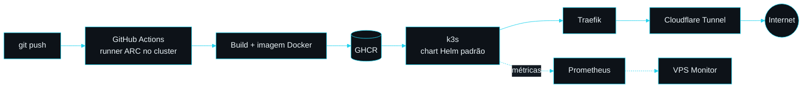

<p align="center">
  
</p>

<p align="center">
  <a href="https://github.com/fabrodiego">
    
  </a>
</p>

<p align="center">
  <a href="https://www.linkedin.com/in/fabrodiego/" target="_blank">
    
  </a>
  <a href="https://github.com/fabrodiego?tab=repositories">
    
  </a>
</p>

---

### 👨‍💻 Sobre mim

Construo APIs em **Java e Spring Boot** e cuido de todo o caminho até a produção: banco, CI/CD, container, cluster e monitoramento. Meus projetos rodam num **cluster k3s próprio**, publicados via Cloudflare Tunnel.

```java
public class DiegoFabro {

    String cargo      = "Desenvolvedor Back-end";
    String foco       = "APIs REST, sistemas escaláveis e automação";

    String[] backend  = {"Java 21", "Spring Boot", "Spring Security", "JPA/Hibernate"};
    String[] dados    = {"PostgreSQL", "MySQL", "MongoDB", "Kafka", "RabbitMQ"};
    String[] infra    = {"Docker", "k3s", "Helm", "GitHub Actions (ARC)", "Cloudflare Tunnel", "Prometheus"};
    String[] extras   = {"Angular", "TypeScript", "Python", "Selenium"};

    String agora      = "Evoluindo o MoneyGuard e a observabilidade da minha VPS";
}
```

---

### 🛠️ Stack

**Back-end e dados**

<p align="left">
  
</p>

**Infra e DevOps**

<p align="left">
  
</p>

**Front-end e automação**

<p align="left">
  
</p>

---

### 📌 Projetos em destaque

| Projeto | O que é | Stack |
|---|---|---|
| 💰 **MoneyGuard**<br>[API](https://github.com/fabrodiego/moneyguard-api) · [Front](https://github.com/fabrodiego/moneyguard-frontend) · [Bot](https://github.com/fabrodiego/moneyguard-discord-bot) | Controle financeiro pessoal com API, painel web e bot no Discord. | Java 21 · Spring Boot · Angular · TypeScript · PostgreSQL |
| 🤖 **Chatbot RGC**<br>[Repo](https://github.com/fabrodiego/api_academia_rgc_chatbot) · [No ar](https://chatbot-rgc.fabrodiego.com) | Chatbot de atendimento para academia, com classificador TF-IDF próprio e Swagger. | Java 17 · Spring Boot · PostgreSQL |
| 📈 **VPS Monitor**<br>[API](https://github.com/fabrodiego/vps-monitor-api) · [Front](https://github.com/fabrodiego/vps-monitor-frontend) | Painel de observabilidade da minha VPS, alimentado pelo Prometheus, com login senha + TOTP. | Java 21 · Spring Boot · Angular · Prometheus |
| 📚 **VibeBooks**<br>[API](https://github.com/fabrodiego/VibeBooks-api) · [Front](https://github.com/fabrodiego/VibeBooks-frontend) | Rede social de livros com API RESTful. | Java · Spring Boot · Angular |
| 📝 **FormsToNotion**<br>[Repo](https://github.com/fabrodiego/FormsToNotion) | Automação que leva respostas do Microsoft Forms para o Notion. | Python · Selenium |

---

### ☁️ Como meus projetos vão para produção



---

### 📊 Atividade no GitHub

<p align="center">
  
</p>

<p align="center">
  
</p>


